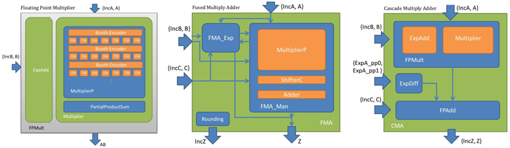

<br/>
<br/>

<br/>
# FP-Gen Floating-Point-Unit Generator

FP-Gen is a floating-point multiply-adder generator and testbench.
It can build and verify pipelined multipliers and/or multiply-add units
of any given exponent/fraction sizes.
Also see [this brief overview](doc/FPGen_user_guide.pdf).

### QUICK DEMO I: QUICK RTL

For a quick demo, run the command below. It should very quickly produce a set
of verilog files `"genesis_{synth,verif}/*.v"` that implement a fast 16-bit
bfloat [cascade multiply add unit (CMA)](doc/FPGen_user_guide.pdf) and testbench.

```
    source scripts/setup.sh  # Verify requirements and install Genesis if needed
    make clean gen           # Build the verilog
```

### QUICK DEMO II: QUICK VERIFICATION with VCS or Verilator

Default verification uses Verilator, a FOSS verilog simulator
[freely available online](https://www.veripool.org/verilator).
Once Verilator is installed, you can run the testbench and
verify your design by simply doing `make clean run`.

Or, if you have access to the Synopsys VCS verilog simulator and
would prefer to use that, you can use the SIMULATOR option.
(VCS-based verification may require setting a `"SYNOPSYS"` environment variable,
see the *Environment* section below for more information.)
```
    make clean run                # Uses default Verilator simulator
    make clean run SIMULATOR=VCS  # Uses Synopsys VCS simulator
```


### QUICK DEMO III: QUICK TAPEOUT

If you have [Docker](https://www.docker.com) installed in your system, the script
`"test/tapeout-fma00bf.sh"` will build a single-cycle bfloat mul-add unit, install
librelane FOSS tools in a docker container, and use them to produce a GDS-II tape
for the librelane default process (skywater 130 maybe).

The process is definitely "quick" for a tapeout, historically, but it's still going to
take awhile, maybe 30 minutes to an hour depending on your system. The final tape will
be in a docker container in a directory called something like `"my_designs/fpgen/runs/RUN*/final/"`,
you should be able to find it by doing `"docker ps"` etc.

For more details, see `test/README.txt`.
```
    % ./test/tapeout-fma00bf.sh
```


### DETAILED INFO

#### To run the generator:
```
  make clean [gen|run] [GENESIS_CFG_SCRIPT=SysCfgs/dp-fma.cfg] [SIMULATOR=VERILATOR]
```
#### Examples:
```
  # Build default[*] mul-add unit, no verification
  make clean gen              

  # Build and verify default mul-add unit
  export SIMULATOR=VERILATOR    # Use Verilator to verify the RTL testbench
  export SIMULATOR=VCS          # Use VCS to verify the RTL testbench OR
  make clean run                # Build and verify

  # Build and verify a 32-bit single-precision cascaded multiply-add unit
  make clean run GENESIS_CFG_SCRIPT=SysCfgs/sp-cma.cfg
```
_[*] The default configuration is a double-precision 7-cycle FMA (fused mul-add)
unit with 3-cycle pipelined Wallace-tree Booth-2 multiplier._


<!--
XXX #### Explanation:
XXX 
XXX * `"gen|run"` just generate the design (gen) or generate and then also run a testbench (gen)
XXX * `"GENESIS_CFG_XML=SysCfgs/changefile.xml"` tells genesis to use the design configuration specified in `changefile.xml`
XXX * `"GENESIS_CFG_SCRIPT=SysCfgs/dp-fma.cfg"` -- an alternative way to load a script for setting configuration
XXX * Replace `SIM_ENGINE=synopsys` with `SIM_ENGINE=mentor` to use mentor simulation tools.
XXX * `"GENESIS_HIERARCHY=new.xml"` redirect the output xml file to file `new.xml` (important for the (unsupported) gui)
-->

#### Environment:
You can do this to help prepare your environment:
```
    source scripts/setup.sh
```
Among other things, the script will check to see if you have
`"Genesis2"` and, if not, will attempt to install it locally for you.
`"Genesis2"` is based on Perl 5, so you need to have that installed
on your system. A standard linux environment should already have it..

Along with `Genesis2`, the generator tool, you'll need at least one other CAD tool
in your path, a Verilog simulator. We currently support Synopsys `"VCS"` and a FOSS
alternative, `"Verilator."`

To check your environment, do "command -v" for the required tools,
and you should get a valid result, e.g.
```
    % command -v Genesis2
      /usr/local/bin/Genesis2

    % command -v vcs
      /cad/synopsys/vcs/Q-2020.03-SP2/bin/vcs

    % command -v verilator
      /usr/local/bin/verilator

    % perl --version
      This is perl 5, version 34... (does not have to be 34 maybe)
```
Without a VCS or Verilator simulator, you can still generate verilog, but you'll be on your own
for running the simulation test afterwards.

Also, for VCS, you'll need to locate the libraries that VCS uses for testing. Default locations are
```
  $SYNOPSYS/dw/sim_ver
  $SYNOPSYS/packages/gtech/src_ver
```
where SYNOPSYS=/hd/cad/synopsys/dc_shell/G-2012.06-SP5-1

If this is not where they exist on your system, you will need to locate them and then set the
SYNOPSYS environment/makefile variable appropriately when doing a `"make run"` verification.

E.g. on your system, suppose you find the designware libraries here:
```
  /mycaddir/synopsys/dc_shell/J-2014.09-SP3/dw/sim_ver
```
Then, instead of e.g.
```
   % make clean run GENESIS_CFG_SCRIPT=SysCfgs/dp-fma.cfg
```
you would do
```
   % make clean run GENESIS_CFG_SCRIPT=SysCfgs/dp-fma.cfg \
       SYNOPSYS=/mycaddir/synopsys/dc_shell/J-2014.09-SP3
```

#### Designware

The main build is supposed to be free of proprietary software i.e. <i>Synopsys Designware,</i> but apparently some of it snuck in.
So, rather than rewrite the existing RTL, I made some clean lookalike modules and put them in the local directory "rtl/dwsub".
```
    % (cd rtl/dwsub/; ls -1 *.v)
        DWSUB01_add.v
        DWSUB01_csa.v
        DWSUB_decode_en.v
        DWSUB_lzd.v
```
To use the original Designware version, specify parameter `"top_FPGen.WHICH_DW=DW"`
in your cfg file. By default, FP-Gen uses the Designware-free version a.k.a.
`"top_FPGen.WHICH_DW=DWSUB"`.

<!--
To use the clean version, specify parameter `"top_FPGen.WHICH_DW=DWSUB"` in your cfg file.
And/or you can specify it on the command line as shown below. Or, if you specify
`"SIMULATOR=VERILATOR"` during code generation, this will be set automatically.
Also, certain configurations set this parameter by default, e.g. `"SysCfgs/bf-cma.cfg"`.
```
    # Any one of these will suffice to compile Designware-free RTL
    make clean run GEN="-parameter top_FPGen.WHICH_DW=DWSUB"
    SIMULATOR=VERILATOR make clean run
    make clean gen GENESIS_CFG_SCRIPT=SysCfgs/bf-cma.cfg
```
-->

### Pre-Built Examples For Comparison

For comparison, the `"examples/"` subdirectory contains the results of a successful
`"make clean run"` building and verifying a double-precision FMA.
<!-- Verilog for the generated FMA is in the `"examples/genesis_verif"` directory and
standard-output from running the `"make"` command is in `"examples/make.log"`. -->
```
    examples/genesis_verif  # Verilog for the generated double-precision FMA
    examples/make.log       # stdout captured from a succeessful "make clean run"
```


## EXTRAS
(Use with caution, these extras have not been tested in years!)
```
To use perl script to run jobs and to plot graphs, do following step:

0. To set up the environment, use
	source ./scripts/setup.sh

1. To compile .vp file and to run synthesis jobs, use:
	./scripts/run.pl [--cluster] [--jobs=50] --xml=XMLFILE --synth=SYNTHSCRIPT

   Example:
	./scripts/run.pl -c -x=Designware_16_syn.xml -s=run_lvt_16.sh -x=Designware_32_syn.xml -s=run_lvt_32.sh  -x=Designware_64_syn.xml -s=run_lvt_64.sh -x=Designware_128_syn.xml -s=run_lvt_128.sh -x=WlcBth2Sqr_16_syn.xml -s=run_lvt_16.sh -x=WlcBth3Sqr_16_syn.xml -s=run_lvt_16.sh -x=WlcBth2Sqr_32_syn.xml -s=run_lvt_32.sh -x=WlcBth3Sqr_32_syn.xml -s=run_lvt_32.sh -x=WlcBth2Sqr_64_syn.xml -s=run_lvt_64.sh -x=WlcBth3Sqr_64_syn.xml -s=run_lvt_64.sh -x=WlcBth2Sqr_128_syn.xml -s=run_lvt_128.sh -x=WlcBth3Sqr_128_syn.xml -s=run_lvt_128.sh

  Description:
	Compile and run Genesis .vp file for each XMLFILE in ./work directory,
	and then run synthesis with target delay script SYNTHSCRIPT.

  Options:
	-c, --cluster: whether you are on a cluster
	-j, --jobs: the maximum jobs to run on the cluster. The default is 50.
	-x, --xml: input xml config file in ./SysCfgs folder to run genesis
	-s, --synth: target delay script in ./synthesis folder to run synthesis
	
	**NOTE: input option XMLFILE must be followed by its SYNTHSCRIPT, 
	and more than one pairs of XMLFILE and SYNTHSCRIPT can be set, but
	the numbers of input XMLFILE and SYNTHSCRIPT must be the same.


2. To collect the synthesis results, use:
	./scripts/collectResults.pl [--folder=FOLDER] -xml=XMLFILE

   Example:
	./scripts/collectResults.pl -x=Designware_16_syn.xml -x=Designware_32_syn.xml -x=Designware_64_syn.xml -x=Designware_128_syn.xml -x=WlcBth2Sqr_16_syn.xml -x=WlcBth3Sqr_16_syn.xml -x=WlcBth2Sqr_32_syn.xml -x=WlcBth3Sqr_32_syn.xml -x=WlcBth2Sqr_64_syn.xml -x=WlcBth3Sqr_64_syn.xml -x=WlcBth2Sqr_128_syn.xml -x=WlcBth3Sqr_128_syn.xml

   Description:
	Collect results for each XMLFILE, the output csv files will be saved
	in FOLDER folder.

   Options:
	-f, --folder: define the folder to save csv files. The default is ./results


3. To plot the graphs, use:
	./scripts/graph.pl [--folder=FOLDER] [--nodisplay] [--Vdd=VDD] [--Vth=VTH] --csv=CSVFILE --desinware=DESIGNWARE_CSV

   Example:
	./scripts/graph.pl -c=WlcBth2Sqr_64_syn.csv -c=WlcBth3Sqr_64_syn.csv -d=Designware_64_syn.csv
	./scripts/graph.pl -n -c=WlcBth2Sqr_64_syn.csv -c=WlcBth3Sqr_64_syn.csv -d=Designware_64_syn.csv 
	./scripts/graph.pl -f=MultP_results -c=WlcBth2Sqr_64_syn.csv -c=WlcBth3Sqr_64_syn.csv -d=Designware_64_syn.csv

   Description:
	Generate a MATLAB script to plot a graph of several result csv files.
	Then run MATLAB, generate the graph and save a pdf version in
	FOLDER folder. --nodisplay option is available for non-GUI
	environment.

   Options:
	-f, --folder: define the folder to get csv files and save pdf file. The default is ./results
	-n, --nodisplay: do not launch MATLAB GUI
	--Vdd: the Vdd we use to plot the graph. The default is 1.0.
	--Vth: the Vth we use to plot the graph. The default is lvt.
```
